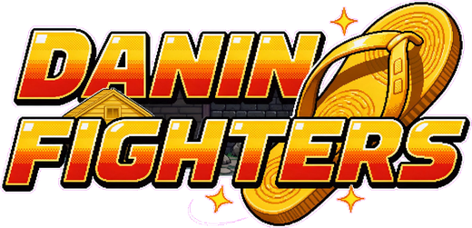
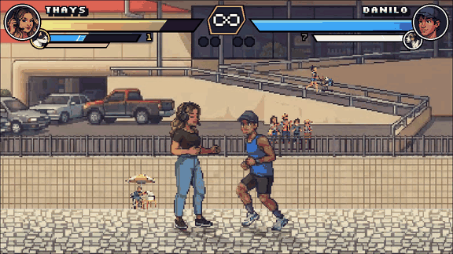
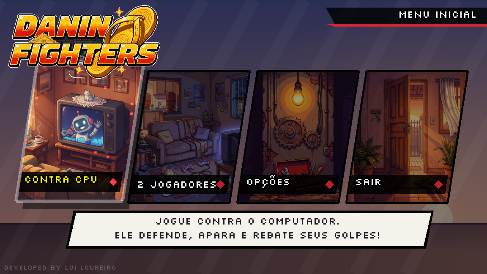
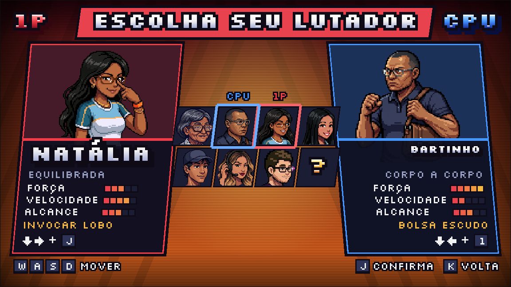
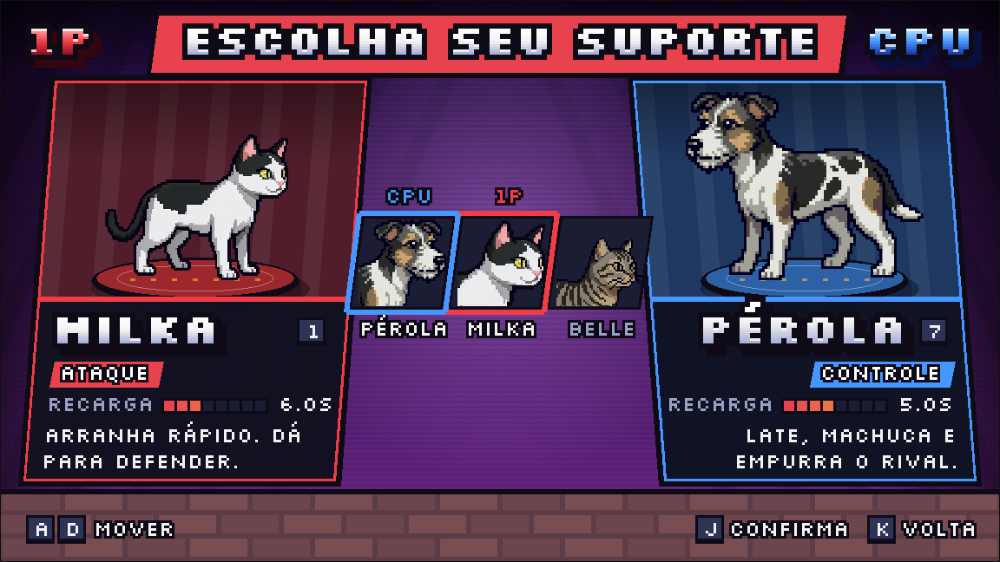
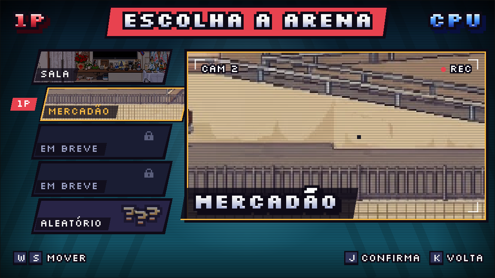
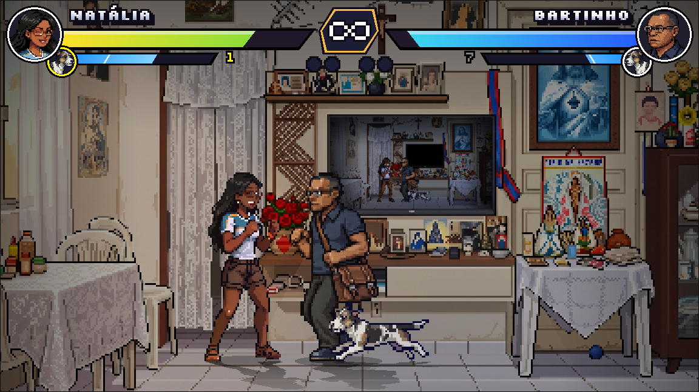
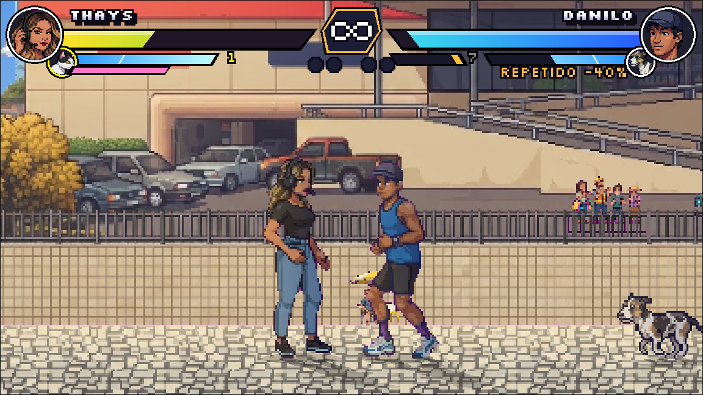
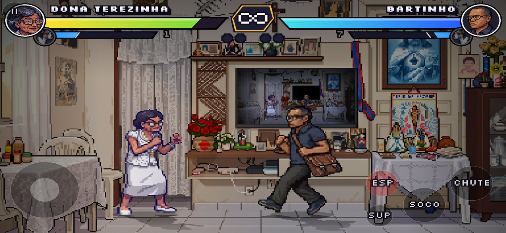

<p align="center">
  
</p>

<p align="center">
  Jogo de luta 2D 1 contra 1, no estilo dos fliperamas dos anos 90, com a família como lutadores.<br>
  Motor próprio em <b>C++17 + raylib</b>, roda no <b>PC</b> e no <b>celular</b> (WebAssembly).
</p>

<p align="center">
  
  
  
  
</p>

<p align="center">
  
</p>

## Sobre

Danin Fighters começou como um protótipo para validar uma ideia: usar pixel art gerada e desenhada para cada pessoa da
família e transformar isso num jogo de luta de verdade, com as regras que fazem o gênero funcionar (startup, active e
recovery dos golpes, defesa alta e baixa, comandos de especial, hitstop, parry).

Não usa engine comercial: o motor (lógica, animação, colisão, câmera, luz, menus e interface) foi escrito do zero sobre a
raylib, em cerca de 7.700 linhas de C++. Todo o conteúdo (personagens, golpes, arenas e mascotes) vem de arquivos JSON,
então um personagem novo entra no jogo sem mudar código.

## Capturas

| Menu inicial | Escolha de lutador |
|---|---|
|  |  |
| **Escolha do suporte** | **Escolha da arena** |
|  |  |
| **Luta na sala** | **Luta no Mercadão** |
|  |  |

**No celular**, com o controle de toque (direcional, golpes e um botão para cada especial do lutador):



## Destaques técnicos

**Pipeline de sprites em tempo de execução.** As folhas de sprite chegam como PNG com fundo magenta, em grade e sem
alinhamento. Ao carregar, o jogo:
- fatia os quadros e remove o fundo por chroma key com tolerância, neutralizando a borda rosada do antialias;
- alinha todos os quadros pelos pés, usando a maior mancha do desenho, para que um objeto solto não levante o personagem;
- escala em fator de pixel (filtro POINT).

**Caixas medidas na própria arte.** Hurtbox, hitbox e colisão do corpo saem dos pixels de cada quadro: o tronco é a
faixa de colunas mais cheia, e o golpe acerta com a ponta do membro que avança, sem o contorno de 1 px. Não existe
caixa desenhada à mão.

**Regras de jogo de luta:**
- comandos com buffer (↓→, ←↓→, frente-frente, parry ↓←), corrente de socos e pulo duplo;
- passar por cima do rival no pulo, defesa alta e baixa, e barra de guarda que quebra;
- dano de defesa proporcional à vida, penalidade para golpe repetido e regra de canto (ninguém fica preso apanhando);
- projéteis que se anulam no ar e parry que devolve o golpe.

**Passo fixo e movimento liso.** A lógica roda a 60 ticks/s. O desenho é interpolado e encaixado na grade de pixels da
tela, então o movimento fica constante em monitores de 60, 144 ou 165 Hz.

**Luz 2D com shaders.** Sombra projetada a partir da silhueta do quadro, penumbra, luz quente e borda de luz do lado do
sol. Uma lição medida no caminho: trocar um uniform de shader entre sprites fazia o driver sincronizar com a placa, e a
luta subia de 7% para até 78% de CPU. A solução foi passar os parâmetros pela cor do vértice.

**Arena com câmera.** O Mercadão tem céu, nuvens, fachada, figurantes e chão em camadas com parallax, além de uma câmera
que segue o meio da luta. Os figurantes têm vida própria: a cliente desce a rampa, a torcida vibra com golpe forte e os
pombos voam quando alguém chega perto.

**PC, web e celular com o mesmo código.** O jogo compila para WebAssembly com Emscripten e pode ser instalado como app
(PWA). No celular aparece um controle de toque multitoque, e cada golpe especial vira um botão que já envia o comando
pronto.

**Testes de regra.** O `fight_test` simula lutas e verifica com asserts 25 cenários: corrente, canto, parry, golpe
repetido, câmera, especiais etc.

## Personagens

| Lutador | Estilo | Especial |
|---|---|---|
| Dona Terezinha | à distância | Cruz de Luz (projétil) |
| Bartinho | corpo a corpo | Bolsa Escudo (parry que devolve o golpe) |
| Natália | equilibrada | Invocar Lobo (lobo espiritual pelo chão) |
| Thayna | equilibrada | Lápis Voador (perde a arma até buscá-la de volta) |
| Danilo | velocista | Furacão (super com vários acertos) e arrancada |
| Thays | controle de área | Bomba de perfume (nuvem que causa dano) e borrifo |
| Lui | versátil | Mouse arremessado, teclado e o Fiesta (atropela) |

Mascotes de suporte, chamados durante a luta:
- **Pérola** late e empurra;
- **Milka** arranha;
- **Belle** cura.

## Como jogar

| Ação | Teclado (P1) | Teclado (P2) | Controle de videogame |
|---|---|---|---|
| Andar / defender | A, D (para trás defende) | ← → | Direcional |
| Pular / agachar | W / S | ↑ / ↓ | Direcional |
| Soco / chute | J / K | Numpad 1 / 2 | X / Y (Quadrado / Triângulo) |
| Especial | S, D, J | ↓ → Numpad 1 | ↓ → Soco |
| Mascote | 1 ou L | Numpad 7 | RB / R1 |
| Pausa | Esc | Esc | Start |

F1 mostra as caixas de colisão, F2 liga ou desliga a CPU e F5 recarrega os JSON e as imagens sem fechar o jogo.

## Como compilar

Pré-requisitos: CMake 3.20+ e um compilador C++17 (testado com Visual Studio 2022). A raylib e a nlohmann/json são
baixadas automaticamente pelo CMake.

```bash
# PC (Windows)
cmake -S . -B build
cmake --build build --config Release
build\Release\briga.exe

# testes de regra
build\Release\fight_test.exe
```

```powershell
# Web / celular (requer o Emscripten SDK e o Ninja)
emcmake cmake -S . -B build-web -G Ninja -DPLATFORM=Web -DCMAKE_BUILD_TYPE=Release
cmake --build build-web
python -m http.server 8080 --directory build-web   # abrir http://localhost:8080
```

## Estrutura

```
src/
  main.cpp        telas, HUD, arena, câmera, áudio e controle de toque
  fighter.cpp/.h  lógica da luta: golpes, comandos, colisão, projéteis, CPU
  sprites.cpp/.h  carregamento das folhas, chroma key, alinhamento, caixas e shaders
  typography.*    fontes pixel (Display e UI)
  fight_test.cpp  testes das regras
assets/
  data/           characters.json, stages.json, supports.json... (todo o conteúdo)
  raw/            folhas de sprite por personagem, mascote e arena
  audio/, sfx/    músicas e efeitos
web/              página, manifesto do app (PWA) e ícones do build web
tools/personagem/ gerador local de sprites para personagens novos
```

## Créditos

Desenvolvido por **Lui Loureiro**. Personagens inspirados na família do autor; pixel art produzida pelo autor, parte com
auxílio de IA generativa, tratada e integrada ao jogo.

Fonte [Silkscreen](https://fonts.google.com/specimen/Silkscreen) (SIL Open Font License). Feito com
[raylib](https://www.raylib.com/) e [nlohmann/json](https://github.com/nlohmann/json).
